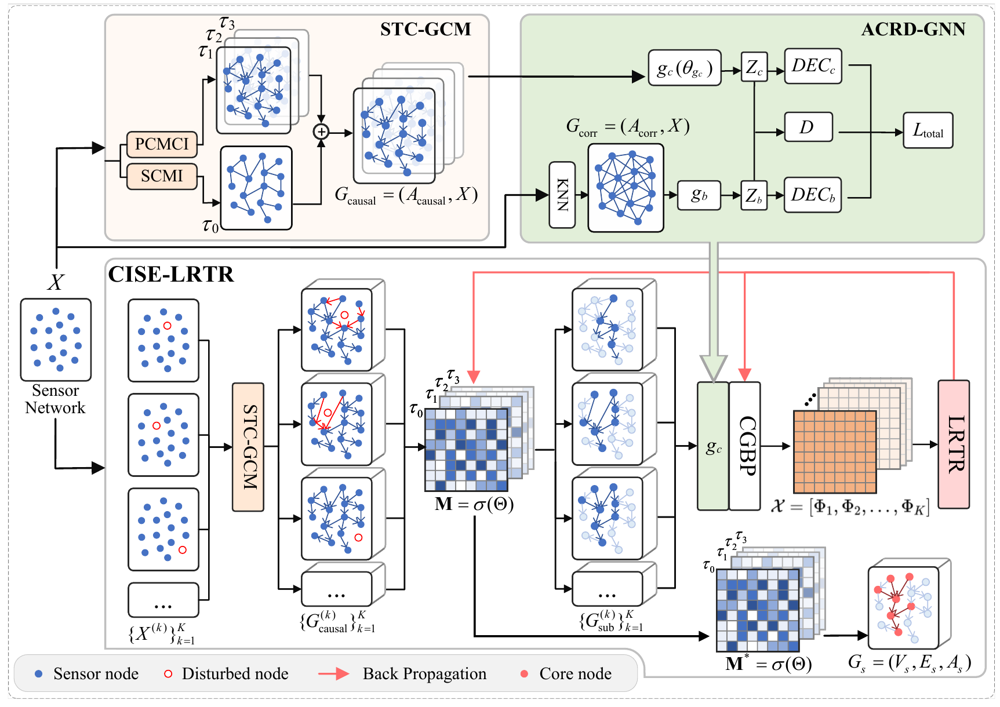
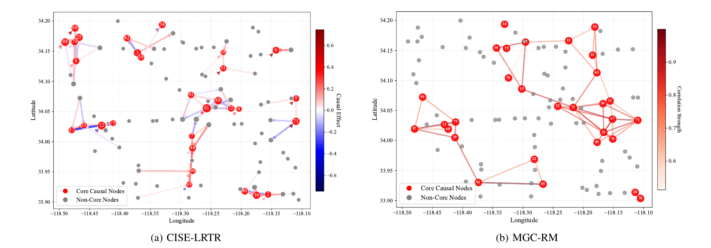
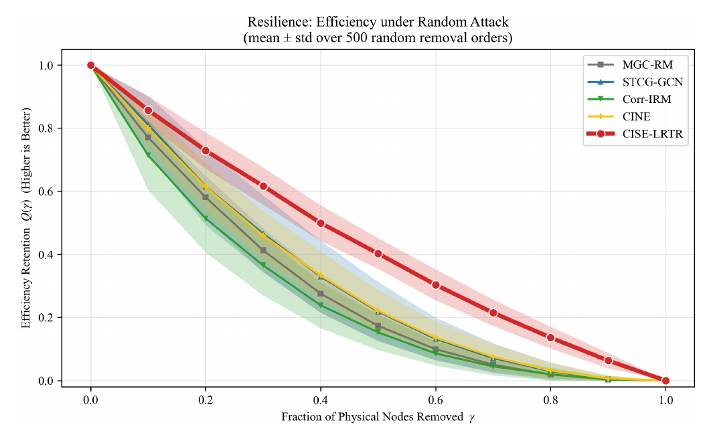

# CISE-LRTR

**基于因果表示解耦与核心子图提取的传感器网络韧性部署优化**

本项目研究如何从时空观测数据中识别跨扰动环境保持稳定的核心因果结构，在控制感知性能损失的同时，减少冗余连接、降低部署成本并提高网络韧性。

**研究成果：第一作者论文，已发表于 IEEE Internet of Things Journal（一区 TOP）。**

> **Resilient Deployment Optimization of Sensor Networks via Causal Representation Disentanglement and Core Subgraph Extraction**
>
> **Chongrong Li**, Hao Yuan, Jiawei Jin, Wei Wang
>
> IEEE Internet of Things Journal, 2026
>
> [论文 / IEEE Xplore](https://ieeexplore.ieee.org/document/11735177)

[方法框架](#方法框架) · [论文结果](#论文结果) · [代码结构](#代码结构) · [运行说明](#运行说明) · [引用](#引用)

## 方法框架



*论文 Fig. 1。图片摘自作者提供的论文稿；完整方法与实验设置见论文。*

| 模块 | 作用 | 主要实现 |
| --- | --- | --- |
| **STC-GCM**：时空因果图构建 | 结合 PCMCI 时间因果发现和 SCMI 空间条件互信息，构建有方向、有时滞的因果图 | `Module/PCMCI_2*.py`、`Module/SCMI*.py`、`utils/Causal_dataset_process*.py` |
| **ACRD-GNN**：对抗因果表示解耦 | 从因果图与相关图中分离因果表示和偏差表示 | `Module/CADGNN*.py`；代码沿用 CADGNN 命名 |
| **CISE-LRTR**：核心不变因果子图提取 | 利用多扰动视图、因果门控双线性投影（CGBP）与低秩张量残差（LRTR），学习稳定的核心结构 | `Module/CausalInvariantSubgraphExtractor*.py`、`Module/pipeline3*.py`、`Module/subgraph4.py` |

```text
时间序列 + 节点位置
    → 时空因果图 / 空间相关骨架
    → 对抗因果表示解耦
    → 删点扰动视图 + 不变子图学习
    → 核心节点与子图
    → 结构识别、任务性能、部署成本与失效韧性评估
```

## 论文结果

主要实验使用合成因果数据与 PeMS 交通传感器数据。以下为论文报告的结果，并非本次代码整理重新运行所得；比较均限定在论文的数据处理与评估协议下。

| 评估项 | 论文报告 |
| --- | --- |
| 合成数据核心边识别 | 边级 F1 为 **10.10%**，相较 CINE 的 7.58% 相对提高 **33.25%**（Table I） |
| PeMS 连接密度 | 密度为 **0.110**，相较 CINE 的 0.116 相对降低约 **5.17%**（Table III） |
| PeMS 任务性能权衡 | RMSE 为 **0.463**，相较 MGC-RM 的 0.424 增加约 **9.20%**，同时降低连接成本并改善韧性（Table III） |
| 随机节点失效 | 在论文的对比方法中，CISE-LRTR 的网络效率维持率衰减最慢（Fig. 10） |

### 核心子图可视化



*论文 Fig. 8。红色节点表示核心节点，灰色节点表示非核心节点；两图的边分别表示因果效应和相关强度。*

### 随机失效下的网络韧性



*论文 Fig. 10。横轴为移除的物理节点比例，纵轴为网络效率维持率；曲线和阴影表示 500 次随机移除顺序的均值与标准差。*

图片来源与图号见 [图片说明](docs/assets/README.md)。

## 代码结构

```text
CISE-LRTR/
├── Module/                         # 因果发现、模型、子图提取与评估
│   ├── run3.py                     # 合成数据主对比入口
│   ├── run3_pems.py                # PeMS 主对比入口
│   ├── pipeline3.py                # 合成数据训练流程
│   ├── pipeline3_pems.py           # PeMS 训练流程
│   ├── subgraph4.py                # 核心节点预算与子图筛选协议
│   ├── metrics2.py                 # 合成数据评估
│   ├── metrics2_pems.py            # PeMS 评估
│   └── random_attack_resilience_pems.py
├── utils/                          # 数据生成、清洗、构图与特征处理
├── docs/assets/                    # README 精选论文图片
└── .gitignore
```

工程保留了多个研究阶段的脚本。新读者建议从 `run3.py` / `run3_pems.py` 开始阅读；数据预处理、因果图构建、编码器训练需要分阶段完成，当前没有覆盖全部步骤的一键复现入口。

运行配置见下文和各入口的 `--help`。指标实现见 `Module/metrics2.py` 与 `Module/metrics2_pems.py`。

## 运行说明

### 环境

建议先使用已有可运行的实验环境。仓库尚未提供锁定版本的依赖清单；下列命令是根据源码导入整理的环境准备起点，不代表已经验证的完整复现环境。可先使用 Python 3.10，并根据本机 CUDA 环境选择合适的 PyTorch 构建。

在项目根目录执行：

```powershell
python -m venv .venv
.\.venv\Scripts\Activate.ps1
python -m pip install numpy pandas scipy scikit-learn matplotlib seaborn networkx joblib tqdm openpyxl
python -m pip install torch torch-geometric tigramite
```

个别历史脚本还有额外依赖；运行前请检查对应脚本的导入和数据路径配置。

### 数据与模型

此发布版只收录源码、说明文档和精选图片。**原始数据、数据库、模型权重、NumPy 矩阵和批量实验输出不随源码发布**，克隆后需要自行准备或重新生成。

保留原有本地目录即可，无需为了发布移动数据：

| 本地内容 | 默认存放位置或格式 |
| --- | --- |
| 时间序列与节点位置 | `dataset/`；CSV，模型输入通常为 `[T,N]`，位置与节点编号一一对应 |
| PCMCI 原图与扰动视图 | `.pkl`；`graph`、`val_matrix` 通常为 `[N,N,tau_max+1]` |
| SCMI 原图与扰动视图 | `.npy`；通常为 `[N,N]`，后续扩展到时空图 |
| 融合矩阵、相关骨架 | `Combined_Results*/`、`Correlation_Graph/` |
| 编码器与掩码检查点 | `Module/CADGNN_results*/`、`Module/causal_invariant_results*/` |
| 对比实验与可视化输出 | `Module/baseline_results*/` 等实验目录 |

不同数据集的节点编号、时间滞后、矩阵方向和检查点维度必须一致。合成实验还需准备真值图与真实核心节点集合。历史脚本中存在本机路径，需要按实际环境调整。

### 主实验入口

安装所需依赖后，从 `Module/` 查看当前参数：

```powershell
Set-Location Module
python run3.py --help
python run3_pems.py --help
```

两个入口默认运行 `B2_GCN_LRTR`、`B3_CORR_IRM`、`B4_NOCGBP`。**完整方法需要显式指定 `--methods FULL_CISE`**，或通过 `--full-mask-dir` 复用已有掩码。MGC-RM 通过 `--mgcrm-pkl` 导入已有子图，此入口不训练 MGC-RM。

PeMS 完整方法命令模板如下。带 `<...>` 的路径需要替换成自己生成的文件；这些输入不包含在仓库中。此命令从已训练编码器和已有扰动图开始，不负责生成这些前置产物。

```powershell
python run3_pems.py `
  --methods FULL_CISE `
  --dataset-dir "../dataset/<PeMS预处理目录>" `
  --feature-csv "id_standardize_Env_A_timeseries.csv" `
  --pos-csv "node_positions.csv" `
  --pcmci-dir "../dataset/<PCMCI扰动目录>" `
  --scmi-dir "../dataset/<SCMI扰动目录>/scmi_perturbations" `
  --pcmci-full-pkl "./PCMCI_PEMS/<实验目录>/<原图文件>.pkl" `
  --cadgnn-path "./CADGNN_results/<实验目录>/<编码器文件>.pth" `
  --node-budget 30 `
  --epochs 100 `
  --seeds 0 `
  --out "./results/pems_cise_lrtr"
```

当前 `pipeline3*` 配置固定为 100 个物理节点、最大时滞 3；合成数据输入维度为 8000，PeMS 为 5085。更换规模或特征长度时需要同步调整源码配置。**检查点路径必须有效**：当前代码在权重缺失时可能回退到随机初始化，这种运行不能视为论文复现。

`run3*` 使用 `subgraph4.py` 的筛选协议。默认 OR 留边规则允许核心节点连接非核心邻居，因此 `--node-budget 30` 指核心节点选择预算，实际边端点数可能大于 30。复用掩码的 `--full-mask-dir` 会重新应用当前筛选协议；`--full-legacy-pkl` 则保留历史子图，不能视为相同的复现方式。

### 已有子图的随机攻击评估

在 `Module/` 下执行，无需重新训练模型，但需要已有对比子图 PKL：

```powershell
python random_attack_resilience_pems.py `
  --pkl-dir "./baseline_results_pems3/pkl" `
  --out "./results/random_attack" `
  --runs 500 --steps 10 --seed 4 --band std
```

该脚本采用攻击前的固定基准计算效率维持率，删除一个物理节点时同时删除其全部时间副本。具体输入文件匹配方式见脚本和 `--help`。

## 仓库发布范围

`.gitignore` 统一排除数据集、数据库及转储、模型、数组与缓存、批量结果、日志和运行时间记录。README 的精选图片单独保存在 `docs/assets/`。

本地操作指南、辅助发布脚本与历史实验记录不属于公开发布内容。`.gitignore` 不会追溯删除已有 Git 历史中的文件。

## 引用

如本项目对研究有帮助，请引用对应论文。下面列出题名、作者、期刊与年份，正式 DOI、卷期和页码以 IEEE Xplore 导出的引用为准。

```bibtex
@article{li2026resilient,
  title   = {Resilient Deployment Optimization of Sensor Networks via Causal Representation Disentanglement and Core Subgraph Extraction},
  author  = {Li, Chongrong and Yuan, Hao and Jin, Jiawei and Wang, Wei},
  journal = {IEEE Internet of Things Journal},
  year    = {2026},
  url     = {https://ieeexplore.ieee.org/document/11735177}
}
```
